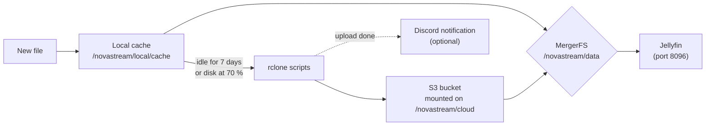

<div align="center">

[](README.md)


# NovaStream

**A Jellyfin library that never fills your disk.**<br>
Recent files stay on a fast local cache, older ones move to an S3 bucket, and Jellyfin sees everything in one folder.

[](LICENSE)
[](docs/guides/SETUP.md)
[](docs/architecture/ARCHITECTURE.md)
[](https://rclone.org)
[](https://github.com/trapexit/mergerfs)
[](scripts)

</div>

> The detailed guides under `docs/` are written in French.

## Why

A media server on a small VPS quickly runs out of disk. Adding local storage is expensive, and moving old files by hand breaks the paths Jellyfin knows about.

NovaStream joins an SSD cache and an S3 bucket under a single mount point. Jellyfin reads `/novastream/data` without knowing where each file lives, and scripts move to S3 whatever has not been read for a week, or whatever pushes the disk past its usage threshold.

## How it works



- **One folder for Jellyfin.** MergerFS merges the local cache and the rclone mount of the bucket. New files always land on local storage (`category.create=ff`), with 25 GB kept free.
- **The disk empties itself.** `check_space_fixed.sh` uploads to S3 past 70 % usage, `move_inactive_fixed.sh` moves files not read for 7 days.
- **On-demand playback.** The rclone mount uses `--vfs-cache-mode full`: an archived file is read in chunks, never pulled back whole.
- **An emergency button.** `emergency_s3_upload.sh` sends the whole cache to S3 when the disk is full; `DRY_RUN=true` shows what would move without moving anything.

## Requirements

- A Linux server with Docker and Docker Compose.
- `rclone` configured with an S3 remote (Scaleway, Backblaze, MinIO or any S3-compatible store).
- `mergerfs` and FUSE.
- Jellyfin in a container. The guides also cover Radarr, Sonarr, Prowlarr and SABnzbd for automatic imports.

## Installation

```sh
git clone https://github.com/pyxl-dev/novastream
cd novastream
```

Then follow the [setup guide](docs/guides/SETUP.md): rclone mount as a systemd service, MergerFS line in `/etc/fstab`, Jellyfin container pointed at `/novastream/data`.

Check that everything is in place:

```sh
./scripts/check_jellyfin_ready.sh
```

## Configuration

Scripts read their settings from the environment:

| Variable | Purpose | Default |
|---|---|---|
| `S3_REMOTE` | rclone remote and bucket (`remote:bucket`) | `s3remote:media-bucket` |
| `DISCORD_WEBHOOK` | Discord webhook for notifications | none (notifications off) |
| `DISCORD_USER_ID` | user to mention in notifications | none |

Logs go to `logs/`, which git ignores.

## Scripts

| Script | Purpose |
|---|---|
| `check_jellyfin_ready.sh` | Checks the mounts and counts the media Jellyfin sees |
| `check_space_fixed.sh` | Uploads to S3 when the disk passes 70 % |
| `move_inactive_fixed.sh` | Uploads to S3 the files not read for 7 days |
| `emergency_s3_upload.sh` | Empties the whole local cache to S3 (`DRY_RUN=true` to test) |
| `monitor_upload.sh` | Follows an upload in progress |
| `upload_completion_notifier.sh` | Pings Discord when an upload ends |
| `fix_permissions.sh` | Resets media file permissions when rclone fails |

## Documentation (French)

- [Architecture](docs/architecture/ARCHITECTURE.md): local storage, cloud, unified view and services.
- [Setup](docs/guides/SETUP.md): from scratch.
- [Data flow](docs/guides/WORKFLOW.md): from a new file to playback in Jellyfin.
- [Integrations](docs/guides/INTEGRATIONS.md): Jellyfin and *arr app APIs.
- [Maintenance](docs/guides/MAINTENANCE.md): preventive tasks.
- [Troubleshooting](docs/troubleshooting/README.md): missing movies, full disk, permissions.

## Limits

- Written for one specific server: paths (`/novastream`, `/opt/stacks`) need adapting.
- The scripts have no automated tests. Run `emergency_s3_upload.sh` with `DRY_RUN=true` first.
- A file on S3 takes a few more seconds to start than a local one.

## License

[MIT](LICENSE). Built with Claude.
