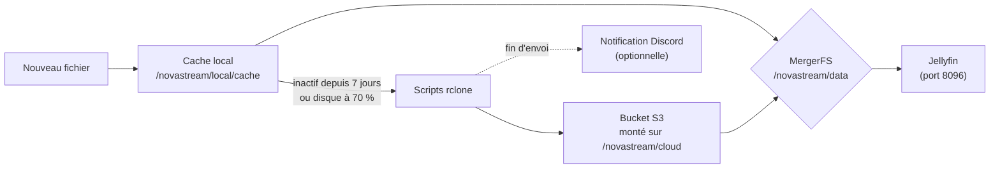

<div align="center">

[](README.en.md)


# NovaStream

**Une médiathèque Jellyfin qui ne remplit jamais ton disque.**<br>
Les fichiers récents restent sur un cache local rapide, les plus anciens partent sur un bucket S3, et Jellyfin voit tout dans un seul dossier.

[](LICENSE)
[](docs/guides/SETUP.md)
[](docs/architecture/ARCHITECTURE.md)
[](https://rclone.org)
[](https://github.com/trapexit/mergerfs)
[](scripts)

</div>

## Pourquoi

Un serveur média sur un petit VPS bute vite sur la taille du disque. Ajouter du stockage local coûte cher, et déplacer les vieux fichiers à la main casse les chemins que Jellyfin connaît.

NovaStream combine un cache SSD et un bucket S3 sous un seul point de montage. Jellyfin lit `/novastream/data` sans savoir où vit chaque fichier, et des scripts déplacent vers S3 ce qui n'a pas été lu depuis une semaine ou ce qui dépasse le seuil d'occupation du disque.

## Comment ça marche



- **Un seul dossier pour Jellyfin.** MergerFS assemble le cache local et le montage rclone du bucket. Les nouveaux fichiers vont toujours sur le local (`category.create=ff`), avec 25 Go gardés libres.
- **Le disque se vide tout seul.** `check_space_fixed.sh` envoie vers S3 au-delà de 70 % d'occupation, `move_inactive_fixed.sh` déplace ce qui n'a pas été lu depuis 7 jours.
- **Lecture à la demande.** Le montage rclone utilise `--vfs-cache-mode full` : un fichier archivé se relit par morceaux, sans être rapatrié en entier.
- **Un bouton d'urgence.** `emergency_s3_upload.sh` envoie tout le cache vers S3 quand le disque est plein ; `DRY_RUN=true` montre ce qui partirait sans rien déplacer.

## Prérequis

- Un serveur Linux avec Docker et Docker Compose.
- `rclone` configuré avec un remote S3 (Scaleway, Backblaze, MinIO ou autre compatible S3).
- `mergerfs` et FUSE.
- Jellyfin en conteneur. Les guides couvrent aussi Radarr, Sonarr, Prowlarr et SABnzbd pour l'import automatique.

## Installation

```sh
git clone https://github.com/pyxl-dev/novastream
cd novastream
```

Puis suis le [guide d'installation](docs/guides/SETUP.md) : montage rclone en service systemd, ligne MergerFS dans `/etc/fstab`, conteneur Jellyfin pointé sur `/novastream/data`.

Vérifie ensuite que tout est en place :

```sh
./scripts/check_jellyfin_ready.sh
```

## Configuration

Les scripts lisent leur configuration dans l'environnement :

| Variable | Rôle | Défaut |
|---|---|---|
| `S3_REMOTE` | remote rclone et bucket (`remote:bucket`) | `s3remote:media-bucket` |
| `DISCORD_WEBHOOK` | webhook Discord pour les notifications | aucun (notifications désactivées) |
| `DISCORD_USER_ID` | utilisateur à mentionner dans les notifications | aucun |

Les logs sont écrits dans `logs/`, ignoré par git.

## Scripts

| Script | Rôle |
|---|---|
| `check_jellyfin_ready.sh` | Vérifie les montages et compte les médias vus par Jellyfin |
| `check_space_fixed.sh` | Envoie vers S3 quand le disque dépasse 70 % |
| `move_inactive_fixed.sh` | Envoie vers S3 les fichiers non lus depuis 7 jours |
| `emergency_s3_upload.sh` | Vide tout le cache local vers S3 (`DRY_RUN=true` pour tester) |
| `monitor_upload.sh` | Suit un envoi en cours |
| `upload_completion_notifier.sh` | Prévient sur Discord à la fin d'un envoi |
| `fix_permissions.sh` | Remet les droits des fichiers média si rclone échoue |

## Documentation

- [Architecture](docs/architecture/ARCHITECTURE.md) : stockage local, cloud, vue unifiée et services.
- [Installation](docs/guides/SETUP.md) : mise en place depuis zéro.
- [Flux de données](docs/guides/WORKFLOW.md) : du nouveau fichier à la lecture dans Jellyfin.
- [Intégrations](docs/guides/INTEGRATIONS.md) : API de Jellyfin et des applications *arr.
- [Maintenance](docs/guides/MAINTENANCE.md) : tâches préventives.
- [Dépannage](docs/troubleshooting/README.md) : films manquants, disque plein, permissions.

## Limites

- Documentation écrite pour un serveur précis : les chemins (`/novastream`, `/opt/stacks`) sont à adapter.
- Les scripts n'ont pas de tests automatisés. Lance `emergency_s3_upload.sh` d'abord avec `DRY_RUN=true`.
- Un fichier sur S3 met quelques secondes de plus à démarrer qu'un fichier local.

## Licence

[MIT](LICENSE). Créé avec Claude.
